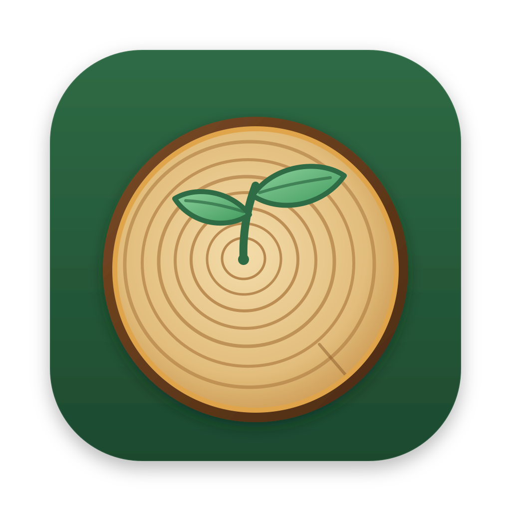
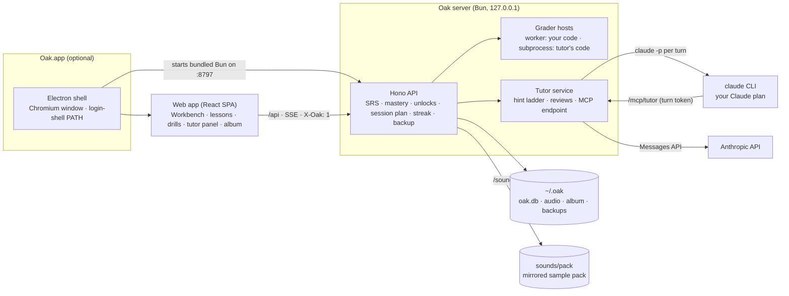

<div align="center">



# Oak

**A music-theory course you take by writing real music in Strudel.**<br>
From pulse and pitch to modes, jazz harmony and transcription, 15–25 minutes a day — for programmers with no musical training, running entirely on your own machine.

[Download](https://github.com/fpl0/oak/releases/latest) · [Run from source](#2-or-run-from-source) · [What's inside](#whats-inside) · [How it works](#how-it-works)

</div>

---

Grow an ear, one ring a day. Oak teaches music theory from zero by having you write real music in [Strudel](https://strudel.cc), the JavaScript port of TidalCycles. Strudel is the instrument; theory is the subject. Every concept arrives **sound first, then code, then symbol**: you hear it, you write it, then you see it on the staff. It is built for a programmer who wants to **compose new music and transcribe existing music**, and it carries:

- **A year-long course in 175 lessons** — 18 core units from pulse and pitch to modulation, then three advanced tracks (jazz harmony, advanced rhythm, arrangement & sound): 259 sessions in all, about a year at five a week.
- **Ear training and singing** — functional, in-key ear drills generated fresh in a new key, register and instrument each time, and pitch grading when you sing into the microphone, all scheduled by FSRS spaced repetition with a cap on the daily warm-up.
- **An album of your own** — every capstone becomes a track on your personal record, and a transcription ladder climbs from generated drum loops to 25 public-domain songs and standards, then to your own audio.
- **A Socratic tutor** — Claude, through your own `claude` login or an API key, hinting on a four-rung ladder. Deterministic graders, never the tutor, decide pass or fail.
- **A macOS app** — `Oak-macos-arm64.dmg` bundles Chromium, Bun, the course and the sound pack; on Linux, or if you prefer, run it from source in Chrome, Arc or Edge.

It is built to be **personal and local-first**: there are no accounts and no cloud, the server listens only on `127.0.0.1`, and your progress lives in a SQLite file in `~/.oak`.

## Contents

- [A daily session](#a-daily-session)
- [Install](#install)
- [What's inside](#whats-inside)
- [How it works](#how-it-works)
- [Development](#development)
- [Documentation](#documentation)
- [Project layout](#project-layout)
- [Known limitations](#known-limitations)
- [Credits and licences](#credits-and-licences)

## A daily session

| | |
|---|---|
| **Warm-up** | About 5 minutes. Spaced-repetition drills, always opening with an easy win. Ear trials are generated fresh each time, in a new key, register and instrument. |
| **New** | About 10 minutes. The next lesson, run as **Predict → Run → Investigate → Modify → Make**. You hum what you think the code will sound like, run it, explore it, then change it while automatic checks grade what you wrote. |
| **Make** | About 4 minutes. A 2–8 bar sketch over a backing band in your chosen flavour — pop, indie, jazz-soul or funk. Even on day 3 it sounds like a song. |
| **Coda** | About 1 minute. What you can now do, any tool you just unlocked, a note from the tutor, and a preview of what's next. |

The **Music Workbench** keeps three views linked — the Strudel editor, a piano roll labelled with scale degrees, and staff notation. Click a note in any view and it lights up in the other two.

## Install

Oak runs two ways: as a **desktop app** on an Apple silicon Mac, or from a **source checkout** served by Bun and opened in your browser. Both keep your progress in `~/.oak`.

### Requirements

- **Desktop app:** macOS 13 or later on Apple silicon
- **From source:** macOS or Linux, [Bun](https://bun.sh) ≥ 1.4.4 and Node ≥ 26, and a Chromium-based browser (Chrome, Arc or Edge)
- Headphones, and a microphone if you want to sing
- *Optional, for the tutor:* [Claude Code](https://claude.com/claude-code) signed in to your Claude account, or an Anthropic API key

### 1. Get the app

**Download** `Oak-macos-arm64.dmg` (265 MB) from the [latest release](https://github.com/fpl0/oak/releases/latest), open it and drag **Oak** to Applications. A zip of the same app and a `SHA256SUMS` file are attached to the release too.

The app is ad hoc signed and not notarised by Apple, so the first time you open it: right-click **Oak** → **Open** → **Open**. (Or run `xattr -dr com.apple.quarantine /Applications/Oak.app`.)

The app bundles Chromium (via Electron), Bun, the course and the sound pack, and runs the same local server as the source version on `127.0.0.1:8797` — not 8787, so it can run beside `bun run start`. Progress lives in the same `~/.oak`, so the two share it. The server log is at `~/Library/Logs/Oak/server.log`, and the tutor finds `claude` on your login shell's `PATH`.

**Or build the app yourself** from a source checkout (step 2), after `bun run build` and `bun run sounds:mirror`:

```bash
cd desktop && npm install && npm run dist   # the DMG and zip land in desktop/release/
```

`OAK_SRC=<checkout>` stages from another checkout, such as a clean worktree of a release commit.

### 2. Or run from source

```bash
git clone https://github.com/fpl0/oak.git
cd oak
bun install
bun run sounds:mirror   # builds the 51 MB pack once from pinned sources (needs lame and flac); checked against sounds/pack.lock.json
bun run oak             # builds the app and starts the server
```

Then open <http://127.0.0.1:8787> and follow onboarding. It unlocks audio, calibrates your headphones, microphone, vocal range and tap latency, and plays your first loop within about 90 seconds.

After the first build, `bun run start` serves the existing build without rebuilding.

> **Tip:** set `OAK_DATA_DIR` to keep data somewhere other than `~/.oak` — for example a throwaway directory while you experiment.

### The tutor

The tutor has two backends, chosen under **Settings → Tutor**:

- **Claude CLI** — runs on your own Claude plan through the `claude` command. If `claude auth status` reports you're signed in, it works with no further setup. Oak gives the CLI no built-in tools; its five learner tools are served over a local MCP endpoint, bound to each turn by a random token.
- **Anthropic API** — paste a key on the same page, or set `ANTHROPIC_API_KEY` in `.env.local`. A pasted key is stored at `~/.oak/secrets/anthropic.key` with mode `0600` and is never sent to the browser. Usage and an estimated cost are shown in Settings, with a soft warning.

The default, **Auto**, uses an API key if there is one, then a signed-in Claude CLI, and otherwise turns the tutor off. Everything except the tutor works without it.

### Your data

| Path | What it holds |
|---|---|
| `~/.oak/oak.db` | SQLite, the single source of truth: progress, SRS cards, sketches, album, tutor threads |
| `~/.oak/audio/` | Your recordings and imported audio |
| `~/.oak/album/` | Audio for your album tracks, one file per version and take |
| `~/.oak/backups/` | Daily automatic database copies (the newest 14 are kept), plus any you make by hand |
| `~/.oak/secrets/` | A pasted Anthropic API key, if any |

**Settings → Data** exports a full backup, audio included, and restores one. For a quick copy of the database from the command line (safe while the server runs):

```bash
bun run db:backup
```

## What's inside

### Curriculum

| Part | Units | Lessons | What it covers |
|---|---|---:|---|
| Core | U00–U04 | 34 | Onboarding, pulse & rhythm, pitch, keyboard & treble staff, the major scale & degrees, intervals |
| | U05–U09 | 41 | Triads, diatonic harmony, melody, bass lines, form |
| | U10–U13 | 29 | Minor, pentatonic & blues, seventh chords, rhythm II |
| | U14–U17 | 21 | Modes, secondary dominants, borrowed chords, modulation |
| *Jazz Harmony* | J1–J5 | 22 | Swing and the ii–V–I, minor ii–V and colour, voicings, comping and walking bass, forms, substitution & reharmonisation |
| *Advanced Rhythm* | R1–R3 | 15 | Feel and the pocket, odd meters & cross-rhythm, clave & Euclidean rhythm |
| *Arrangement & Sound* | A1–A2 | 13 | Sound design, arrangement & mix |

Around the lessons sit 13 core checkpoints, 30 core capstone sessions and 17 Transcription Gym sessions; the tracks add 4 checkpoints and 20 capstone sessions. The tracks open as the core reaches them — the first *Arrangement & Sound* lessons after U03.L02, *Jazz Harmony* and *Advanced Rhythm* after the U13 checkpoint.

### Features

- **Capstones that become an album.** Each capstone is a track on your personal record, with cover art drawn as tree rings generated from the music, liner notes listing the theory you used, and a version history. Tracks export offline.
- **A transcription ladder.** It climbs from generated drum loops to bass lines, chord loops, melodies, public-domain folk songs and pre-1930 standards, then to your own audio. Every answer is Strudel code you can A/B against the original, with time-stretch, pitch shift and A–B looping.
- **Ear training and singing.** Functional, in-key ear drills — degrees, intervals, chord quality, bass lines, schemas, modes, jazz, rhythm. You sing into a microphone and Oak grades your pitch with tolerances that tighten as you improve. **Quiet mode** turns the mic off, and singing never gates progress.
- **Spaced repetition that respects your time.** FSRS scheduling, with a governor that caps the daily warm-up. A 300-day simulation in CI checks that it stays within budget.
- **A toolbox that grows with you.** Strudel functions, instruments and effects unlock with the concept that justifies them. For example, `.voicing()` unlocks only after you've voiced inversions by hand.
- **The Oak.** The skill map is a tree. Each concept is a leaf, and it fades only when a review is genuinely overdue.
- **Streaks without guilt.** The main streak counts weeks in which you met your goal. Rest days are banked, and a missed day can be repaired within 48 hours.
- **A Socratic tutor (Claude).** A docked panel that knows your lesson, step, code and progress. It gives graded answers only through a four-rung hint ladder (nudge → pointer → partial → reveal), and the server withholds solutions until the last rung. It reviews capstones and transcriptions, but **it never decides pass or fail**; deterministic graders do.

## How it works



- **Web app** (`app/src/main.tsx`) — a Vite + React SPA: the workbench, lessons, drills, tutor panel, studio, transcription and album. Strudel plays in the browser behind the `@oak/strudel` adapter, and the microphone's pitch tracking runs in an AudioWorklet.
- **Server** (`server/src/main.ts`) — Hono on `Bun.serve`, bound to `127.0.0.1` only (port 8787 from source, 8797 in the desktop app). It owns SQLite through `bun:sqlite` with migrations, the course services, the daily backup, and the self-hosted sound pack. Request and response shapes are zod contracts shared with the app through `@oak/api`.
- **Graders** (`server/src/grader/host.ts`, `packages/grader/`) — evaluate Strudel headlessly and match the result musically: rhythm F-measure, transposition-invariant melody alignment, chords by bass, root and quality, Roman numerals by degree (never by string), cadences, voice leading, swing ratio. Your own code runs in a Bun worker; code you didn't type (from the tutor, say) runs in a separate subprocess under a stricter lint profile. Both start with an empty environment and disable the `Function` constructor after setup.
- **Tutor** (`server/src/tutor/compose.ts`) — threads, redaction, tools and reviews behind one backend interface: one `claude -p` process per turn with no built-in tools and Oak's own MCP endpoint, or the Anthropic SDK. Answers stream over SSE. See [`server/src/tutor/README.md`](server/src/tutor/README.md).
- **Security** (`server/src/security.ts`) — the server checks `Host`, `Origin` and an `X-Oak` header on every API call and sets a strict CSP. Destructive endpoints require a single-use confirmation nonce (`server/src/confirm.ts`).
- **Desktop shell** (`desktop/main.cjs`) — Electron supplies Chromium, which Oak needs; a bundled Bun runs Oak's own server with `~/.oak` as the data folder. The window frame is drawn in Oak's theme.

### Stack

| Area | Choice |
|---|---|
| Runtime | Bun for the server, tests and grader; Node for frontend tooling; Electron for the desktop app |
| Frontend | Vite 8, React 19 with the React Compiler, TanStack Router and Query, Zustand, XState 5, Tailwind 4, MDX 3 |
| Music | Strudel 1.2/1.3 behind the `@oak/strudel` adapter; tonal for theory; abcjs for the staff; pitchy in an AudioWorklet for the mic; signalsmith-stretch and wavesurfer for transcription |
| Scheduling | ts-fsrs (FSRS) behind `@oak/srs`, with the review-load governor |
| Data | SQLite via `bun:sqlite`, with migrations and zod contracts shared through `@oak/api` |
| Tutor | `claude` CLI with a local MCP endpoint, or the Anthropic SDK; streaming over SSE |
| Quality | TypeScript 7, Biome with enforced import boundaries, `bun test`, Vitest browser mode, Playwright |

## Development

```bash
bun run dev
```

This runs three things side by side: the API server (`OAK_DEV=1`, watching for changes) on port 8787, Vite on <http://127.0.0.1:5173>, and the content compiler in watch mode. Dev mode adds `/dev/listen` (listen QA for examples), `/dev/telemetry` (real step times and review load) and `/dev/qa` (the "report a grading problem" queue).

Useful environment variables, which apply only with `OAK_DEV=1`:

| Variable | Effect |
|---|---|
| `OAK_TUTOR_FAKE=1` | A scripted fake tutor answers instead of Claude |
| `OAK_NOW=<ISO date>` | The dev clock starts at that instant, for testing streaks and schedules |
| `OAK_PORT`, `OAK_VITE_PORT` | Override the default ports (8787, 5173) |

### Checks

| Command | What it does |
|---|---|
| `bun run check` | Typecheck every project and package, Biome lint, and the unit tests |
| `bun run test` | Unit tests only (`bun test --isolate`): about 21,000 tests, and slow. Pass a path to narrow it, e.g. `bun test server/src/tutor` |
| `bun run test:content` | Content validation alone |
| `bun run e2e` | The Playwright browser suite with fake-microphone WAVs, run in parallel by area |
| `bun run lint` / `bun run format` | Biome |

Content validation is part of the unit tests. For every lesson it checks that:

- every code sample evaluates headlessly and isn't silent;
- every reference solution passes and every known-wrong answer fails with its expected feedback;
- IDs resolve, and every tool is unlocked before it's used;
- every sound exists and every effect control is audible;
- every notated example renders;
- every lesson fits its time budget.

A required rule checks what is *heard*, not which function was called. Each graded step carries a wrong answer that uses the right function, plus several different right answers.

### Authoring content

| Command | What it does |
|---|---|
| `bun run content:new` | Scaffolds a lesson |
| `bun run content:check <lesson-id>` | Validates one lesson |
| `bun run theory` | A CLI over `@oak/theory` for checking music-theory claims |

Each lesson folder holds `lesson.ts` (the typed truth: code, exercises, grading, unlocks) and `lesson.mdx` (prose only). Read [`content/AUTHORING.md`](content/AUTHORING.md) and [`content/STYLE.md`](content/STYLE.md) before writing. `STYLE.md` is the Strudel dialect spec that the lint enforces.

## Documentation

| Document | What it covers |
|---|---|
| [`docs/PLAN.md`](docs/PLAN.md) | The approved plan: the daily experience, the full curriculum, architecture, and the implementation waves |
| [`docs/design/contracts.md`](docs/design/contracts.md) | The binding contracts. Where any other doc disagrees, this one wins |
| [`docs/decisions.md`](docs/decisions.md) | The running log of decisions, defaults and gate results |
| [`docs/design/`](docs/design/) | Curriculum, exercises, UX and architecture designs, critiques, and per-wave seam docs |
| [`docs/design/retry.md`](docs/design/retry.md) | How every judged exercise can be retried |
| [`docs/spikes.md`](docs/spikes.md) | Toolchain facts verified during de-risking |
| [`server/src/tutor/README.md`](server/src/tutor/README.md) | The tutor service and its two backends |

## Project layout

```
app/        Vite + React SPA: workbench, lessons, drills, tutor panel, studio, transcription, album
server/     Hono on Bun.serve: SQLite, course services, the headless grader host and the tutor
packages/   api, theory, grader, notation, pitch, drills, srs, content-kit (isomorphic); strudel, audio (browser only)
content/    core and advanced lessons, capstones, repertoire, the toolbox and skill graph, and validation
desktop/    the macOS app: Electron shell, icon, staging and packaging scripts
sounds/     pack.lock.json (committed); pack/ is the local mirror (ignored)
scripts/    content build, sound pack, e2e runner, backup
e2e/        Playwright browser specs and their support files
tests/      smoke tests
types/      ambient type declarations and the import-boundary test
patches/    a patch to a third-party dependency
docs/       the plan, binding contracts, design docs, decision log
```

## Known limitations

- **Chromium only:** audio worklets, the microphone path and the tests target Chrome, Arc and Edge. The desktop app brings its own Chromium.
- **Apple silicon only for the app:** the release is an arm64 build for macOS 13 or later. On an Intel Mac or Linux, run Oak from source.
- **Not notarised:** the app is ad hoc signed, so macOS asks before the first launch — right-click **Oak** → **Open**.
- **Single learner, single machine:** no accounts and no sync, by design. Back up `~/.oak` if your progress matters to you.
- **The sound pack is built from pinned public sources** on first setup (about 430 MB downloaded once into `sounds/pack/.sources/`), so that step needs the network. After that, Oak runs offline, apart from the tutor.
- **Repertoire is public-domain only:** traditional melodies and songs published in 1930 or earlier.

## Credits and licences

Oak is built on, and redistributes, work from many projects; each keeps its own licence.

- **Music engine:** [Strudel](https://strudel.cc) (`@strudel/*` and `superdough`, AGPL-3.0-or-later; [source](https://codeberg.org/uzu/strudel)).
- **Music libraries:** [tonal](https://github.com/tonaljs/tonal) (MIT), [abcjs](https://abcjs.net) (MIT), [pitchy](https://github.com/ianprime0509/pitchy) (MIT), [signalsmith-stretch](https://www.npmjs.com/package/signalsmith-stretch) (MIT), [wavesurfer.js](https://wavesurfer.xyz) (BSD-3-Clause), [ts-fsrs](https://github.com/open-spaced-repetition/ts-fsrs) (MIT).
- **App and server:** [React](https://react.dev) (MIT), [CodeMirror](https://codemirror.net) (MIT), [Hono](https://hono.dev) (MIT), [Bun](https://bun.sh) (MIT), [Electron](https://www.electronjs.org) (MIT), the [Anthropic TypeScript SDK](https://github.com/anthropics/anthropic-sdk-typescript) (Apache-2.0). Fonts: Fraunces, Inter and JetBrains Mono (SIL OFL 1.1).
- **Sound pack (v4):** built by `bun run sounds:mirror` from pinned sources and redistributed under their licences — Salamander Grand Piano V3 by Alexander Holm (CC BY 3.0); jRhodes3d by Jeff Learman (CC BY 4.0); under CC0, the Versilian Community Sample Library and VSCO 2 Community Edition (Versilian Studios), Karoryfer Samples' Big Rusty Drums, Swirly Drums, Shinyguitar and D. Smolken's double bass, Virtuosity Drums, FreePats' electric bass, clean guitar and drawbar organ, Sonic Pi's bundled samples, and the AKWF-FREE single-cycle waveforms by Kristoffer Ekstrand; uzu-drumkit (Unlicense); and General MIDI presets from webaudiofontdata (FluidR3 GM by Frank Wen, MIT, plus older presets kept under a dated exception, because their source SoundFonts' licences could not be verified). Oak's own renders — the oak808 and oak909 drum machines, the breaks, the tape bed and four wavetables — are released under CC0 1.0. Every source, its author, licence and Oak's changes are listed under **Settings → About** and in `sounds/pack/v4/CREDITS.md`, with the licence texts in `sounds/pack/v4/LICENSES/`.
- **Repertoire:** traditional melodies and songs published in 1930 or earlier, all in the public domain.

Oak itself is licensed under [AGPL-3.0-or-later](https://www.gnu.org/licenses/agpl-3.0.html), the same licence as Strudel.

Built with [Claude Code](https://claude.com/claude-code).
